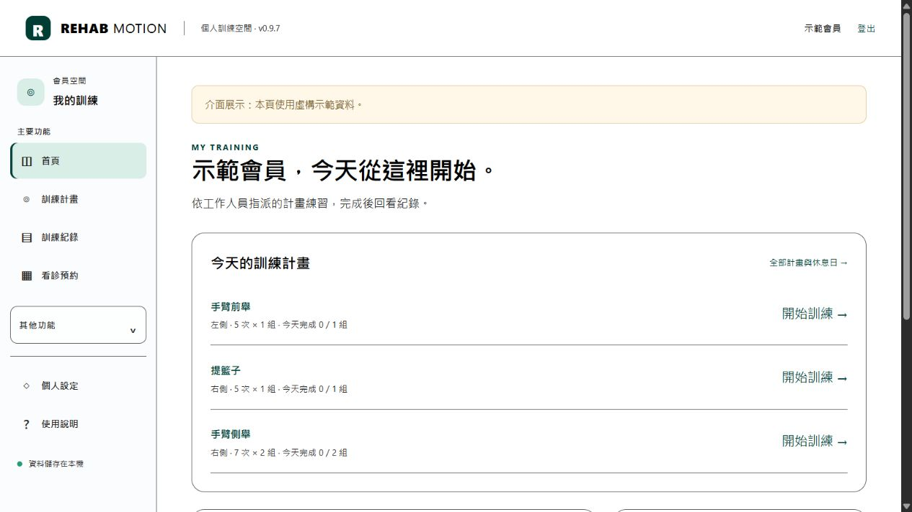
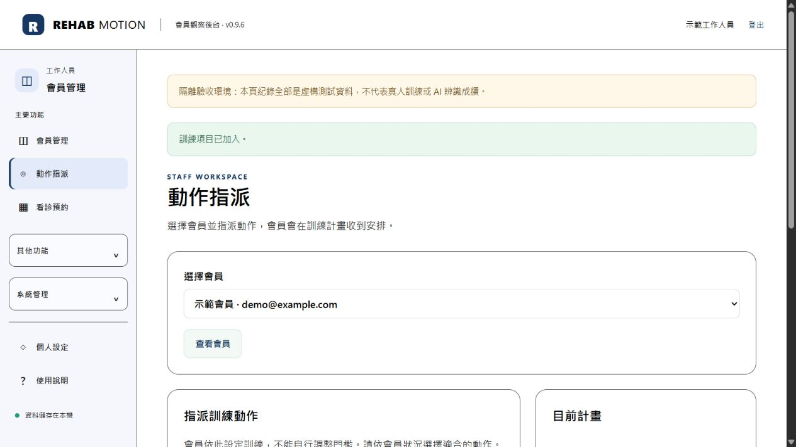

# Rehab Motion

### 復健動作分析平台

**大學專題 · 影像辨識 · 全端系統整合**

從姿態估測、動作計數，到會員訓練與工作人員回饋。

本作品源自**大學時期的畢業專題**，後續持續整理與重構，發展為結合影像分析與會員服務的全端系統。以姿態估測、關節角度規則、指派訓練計畫及工作人員回看，讓一次動作從影像輸入走到可追溯的結果與回饋。

> 此儲存庫僅公開作品介紹與使用虛構示範帳號的介面截圖，不包含應用程式原始碼、資料庫、原始人體影像或模型。完整程式碼保持私人。

## 作品目標

- **會員**：依工作人員指派計畫訓練，查看即時提示、歷史與趨勢，回報感受及接收回覆。
- **工作人員**：在指派範圍內查看數據、保存內部觀察、標記處理狀態及調整計畫版本。
- **管理者**：管理帳號與指派，停用帳號，執行手動備份及副本還原演練。

帳號服務提供電子郵件驗證、忘記密碼寄信重設與信箱變更，搭配角色權限，讓不同身分有各自的操作空間。

## 介面展示

### 會員：依計畫開始訓練

會員首頁集中呈現今日指派計畫、訓練紀錄與看診預約；從計畫進入訓練後可選攝影機、暫停或取消。分析門檻由工作人員設定，後端核對有效計畫；結果保存當時設定，避免後續修改混淆歷史。

### 工作人員：動作指派與會員觀察

後台以會員管理、動作指派、看診預約為主要入口，可指定動作、側別、次數、組數與休息時間。統計排除人工及教學展示資料。內部筆記與會員可見回覆分離，工作人員僅能查看已指派會員。

## 核心流程

1. **指派計畫**：工作人員設定動作、側別、次數、組數與休息時間。
2. **開始訓練**：會員選擇已指派計畫，使用影片或攝影機進行練習。
3. **分析動作**：系統追蹤關節位置、計算角度與完整動作次數。
4. **保存紀錄**：保留分析結果、事件時間與當次計畫設定。
5. **回報感受**：會員記錄訓練感受，提出疑問。
6. **回看與回覆**：工作人員查看數據、保存觀察並回覆會員。
7. **通知與回顧**：會員接收站內通知，查看歷史與訓練趨勢。

## 技術與工程實作

| 面向 | 實作內容 |
| --- | --- |
| 影像分析 | MediaPipe Pose Landmarker、OpenCV、二維角度、時間正規化平滑及完整循環計數 |
| 前端 | Jinja、原生 JavaScript／CSS、Canvas 曲線與姿態疊圖、階段提示及動態效果 |
| 後端 | Flask、Waitress、SQLite、角色／指派權限、CSRF、密碼雜湊及速率限制 |
| 可追溯性 | 動作參數、計畫版本、來源標示、觀察歷史與稽核事件 |
| 工作處理 | 原生推論子程序、容量與逾時管理、Windows 資源限制及取消流程 |
| 資料服務 | 個人資料匯出、本人確認刪除、手動備份與副本還原驗證 |

